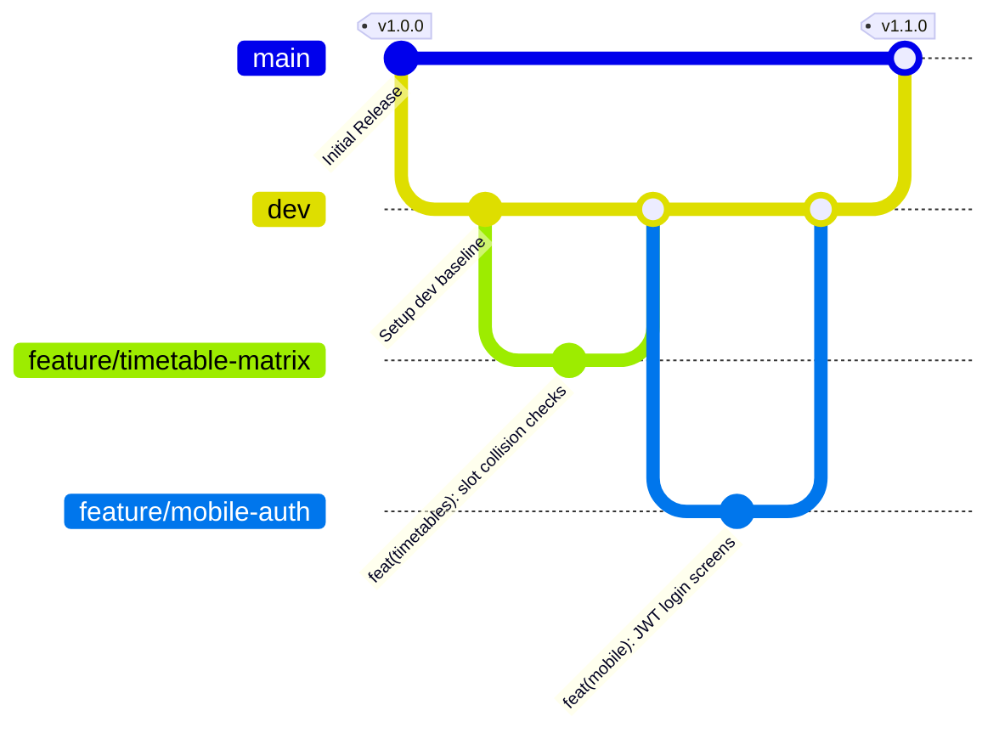

# Git Branching Strategy & Multi-Agent Collaboration Protocol
### Lahore Garrison University (LGU) Enterprise Platform

To ensure multiple AI coding agents and engineering teams collaborate seamlessly without file overwrites or merge collisions, all development in this repository strictly adheres to this standard.

---

## 🌳 Branch Hierarchy



---

## 📌 Branch Definitions & Access Rules

### 1. `main` Branch (Production Stable)
- **Role:** The pristine, production-ready source of truth.
- **Rules:**
  - ⛔ **Direct commits strictly forbidden.**
  - Merges only accept release pull requests from `dev`.
  - Every merge onto `main` triggers a semantic release tag (e.g., `v1.0.0`, `v1.1.0`).

### 2. `dev` Branch (Integration Baseline)
- **Role:** The primary staging branch where all tested, approved features converge.
- **Rules:**
  - ⛔ **No raw, unvetted experimental code.**
  - All new feature branches MUST branch off the latest `dev`.
  - Feature branches merge into `dev` via tested Pull Requests.

### 3. Feature & Fix Branches (Active Workspaces)
All work happens in isolated, short-lived branches created from `dev`:
- `feature/<module>-<short-description>`: New functional capabilities (e.g., `feature/timetables-clash-detector`, `feature/mobile-bus-tracker`).
- `bugfix/<module>-<short-description>`: Bug resolutions during active development (e.g., `bugfix/auth-token-expiry`).
- `hotfix/<short-description>`: Urgent patches branched directly from `main` to address critical production flaws.

---

## 🤖 Multi-Agent Conflict Prevention Protocol

When multiple AI coding agents work concurrently on this codebase:

1. **Domain Isolation:**
   - **Agent A (Backend Team):** Operates strictly within `/backend` on `feature/backend-*`.
   - **Agent B (Mobile App Team):** Operates strictly within `/mobile-app` on `feature/mobile-*`.
   - **Agent C (Web Admin Team):** Operates strictly within `/admin-web` on `feature/admin-*`.
2. **Fresh Synchronization:**
   - Before starting any task:
     ```bash
     git checkout dev
     git pull origin dev
     git checkout -b feature/<your-task>
     ```
3. **Conventional Commits:**
   - `feat(module): description`
   - `fix(module): description`
   - `chore(module): description`
   - `refactor(module): description`
4. **Rebase Before Merging:**
   - Keep history clean and resolve conflicts locally:
     ```bash
     git fetch origin dev
     git rebase origin/dev
     ```
